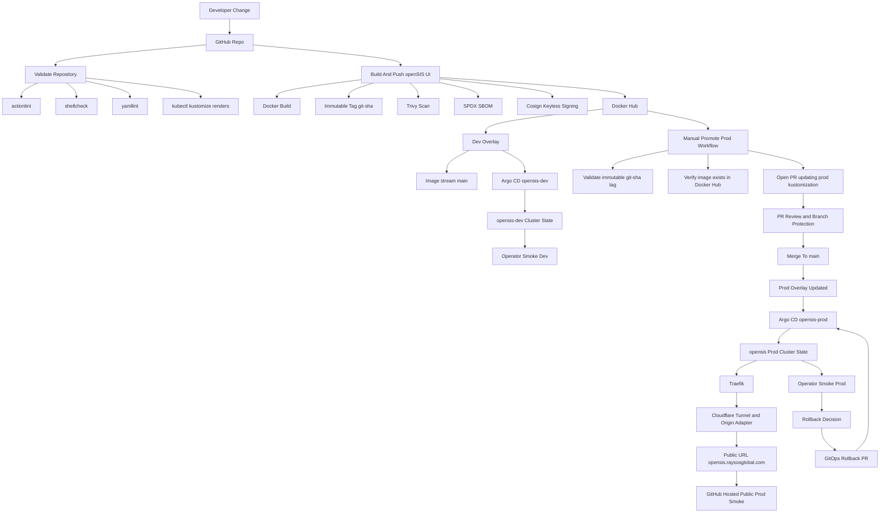
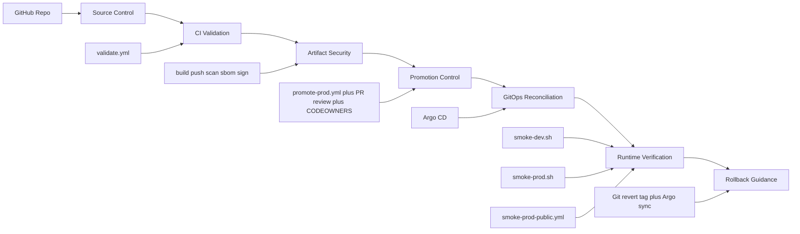

# Production-Grade CI/CD Blueprint

This guide defines the target CI/CD operating model for this repository now that the application, GitOps, Vault, Cloudflare, and session architecture are stable enough to support a more deliberate delivery pipeline.

It is intentionally separate from the bootstrap guide. The bootstrap guide explains how the platform was brought up. This document explains how changes should move safely from source code to production.

See also:

- [Kubernetes Base](README.md)
- [GitOps Layer](gitops/README.md)
- [Overlays](overlays/README.md)
- [From-Scratch Local Bootstrap](FROM_SCRATCH_LOCAL_BOOTSTRAP.md)

For the shorter public-facing guides that sit beside this blueprint, also use:

- [Kubernetes Bootstrap Guide](../docs/03-kubernetes-bootstrap-guide.md)
- [Operations Runbook](../docs/04-operations-runbook.md)
- [Troubleshooting Guide](../docs/05-troubleshooting-guide.md)
- [Architecture Reference](../docs/06-architecture-reference.md)

## Why This Phase Exists Now

This phase is being added now because the platform has crossed an important maturity threshold:

- `dev` and `prod` are both running under GitOps
- Vault-backed secret delivery is in place
- Cloudflare public access is stable
- `prod` session handling is durable and validated at `2` replicas
- `dev` and `prod` are much closer in runtime behavior than before

That makes this the right time to design a true production-grade pipeline.

If CI/CD is added too early, it just automates drift, instability, and manual rescue work. At this stage, the platform is stable enough that automation can reinforce good behavior instead of amplifying bad behavior.

## Design Goals

The target pipeline should be:

- reproducible
- security-first
- GitOps-driven
- promotion-based
- auditable
- reversible

For this project, production-grade means:

- every deployable artifact is traceable back to a Git revision
- `prod` only runs tested immutable artifacts
- secrets do not live in GitHub Actions logs, plaintext repo files, or long-lived CI credentials
- delivery to Kubernetes happens through Argo CD reconciliation, not direct cluster mutation from CI
- failed quality gates stop promotion before `prod`
- rollback is a documented operational action, not an improvisation

## Core Approach

The recommended approach is to build the delivery model in layers.

### 1. Separate CI from CD

CI should answer:

- does the code build
- does it pass validation and tests
- is the image safe enough to promote
- is the artifact signed and traceable

CD should answer:

- which already-approved artifact should run in each environment
- has Git been updated to declare that desired state
- has Argo CD reconciled the cluster to that state

This separation keeps responsibilities clear and reduces the blast radius of automation mistakes.

### 2. Use Promotion Instead of Rebuilding Per Environment

The same built artifact should move through the path:

- build once
- validate once
- promote by reference

For this repository, that means:

- `dev` may track a mutable integration stream such as `main`
- `prod` should be promoted only by an immutable image reference such as `git-<sha>`
- later, the strongest version of this model is to pin `prod` by image digest

### 3. Keep GitOps as the Deployment Authority

GitHub Actions should not be the actor that applies production manifests directly.

Instead:

- CI builds and verifies artifacts
- a promotion step updates Git
- Argo CD reconciles the cluster from Git

This keeps production delivery auditable and aligned with the current platform design.

### 4. Make Security Controls Default

Security should not be a final polishing step. It needs to be present in the first production-grade version of the pipeline:

- least-privilege workflow permissions
- pinned GitHub Actions by commit SHA where practical
- secret scanning
- dependency scanning
- image scanning
- SBOM generation
- signed images
- provenance or attestation where possible
- protected environments for production approvals

## Implementation Status

Current blueprint progress:

- Phase A: complete
  - separate CI/CD blueprint documented in this file
  - promotion model, GitOps authority, and security-first direction defined
- Phase B: complete
  - dedicated repository validation workflow implemented and passing
  - shell and YAML validation scope tuned to repo-owned infrastructure and helper scripts
  - Kustomize render validation now covers base, dev, prod, cloudflare, and argocd
  - workflow permissions explicitly reviewed and kept at least privilege (`contents: read`)
  - pull-request validation now follows the same scoped trigger model as push validation
- Phase C: complete
  - UI image workflow now resolves an immutable `git-<sha>` tag for scanning
  - Trivy image scanning added in report mode to establish a vulnerability baseline before enforcing a hard gate
  - workflow now retains Trivy scan output and an SPDX SBOM as build artifacts for 30 days
  - immutable image digests are now signed with keyless Cosign using GitHub OIDC
- Phase D: complete
  - manual prod promotion workflow is verified end to end through PR creation, merge, and Argo reconciliation
  - private-repo approval is defined through PR review, branch protection, and Code Owners
- Phase E: complete
  - repeatable operator-run smoke scripts now exist for `dev` and `prod`
  - public-prod smoke failure reporting is automated through a GitHub-hosted workflow that checks only the reachable public edge
  - private local-cluster reachability constraints are documented as the reason cluster-internal and `dev` verification remain operator-run

Recently completed milestone:

- `Validate Repository` is now an active CI gate and verifies:
  - GitHub Actions workflow linting with `actionlint`
  - shell script linting with `shellcheck`
  - infrastructure YAML linting with `yamllint`
  - Kustomize render checks for the repo's core deployment layers

Why this matters:

- broken manifests and scripts are now caught before image publication or GitOps reconciliation
- validation scope is strict enough to protect the platform, but narrow enough to avoid failing on vendored or unrelated app content
- this is the first real production-grade delivery control implemented from the blueprint

Operational note from the latest hardening work:

- GitOps syncs that update Vault trust for injected workloads can briefly restart multiple `prod` pods at once and move `opensis-prod` through `OutOfSync` and `Progressing` before it settles back to `Synced` and `Healthy`
- in this repository that behavior was expected when the namespace-local `vault-agent-ca` secret and injector TLS annotations were introduced for `opensis-ui`, `opensis-db`, `opensis-db-backup`, `grafana`, `alertmanager`, and `mysqld-exporter`
- the correct operator response is to verify that replacement pods complete `vault-agent-init`, become `Ready`, and that the public URL still returns `200`, rather than treating the temporary Argo drift as an unexplained failure

## Architecture Diagram

### End-To-End Flow



### Control Layers



Diagram notes:

- `validate.yml` is the repo quality gate before changes move further.
- `dockerhub-opensis-ui.yml` produces the deployable and trusted image artifacts.
- `promote-prod.yml` changes Git, not the cluster.
- Argo CD remains the deployment authority.
- `smoke-dev.sh`, `smoke-prod.sh`, and `smoke-prod-public.yml` provide the verification model for this phase.
- rollback follows the same GitOps path as promotion.

## How A Push Moves Through The Stack

When a change is pushed, GitHub first evaluates which files changed and then triggers only the workflows that match those paths. This keeps the pipeline efficient and avoids rebuilding the UI image for documentation-only or most GitOps-only changes.

### 1. Repository Validation Runs First

If the change touches repository validation scope, [validate.yml](../.github/workflows/validate.yml) runs and verifies:

- GitHub Actions workflow syntax with `actionlint`
- shell helper scripts with `shellcheck`
- infrastructure YAML with `yamllint`
- Kubernetes renderability with `kubectl kustomize`

This is the first safety gate and prevents obviously broken workflow, shell, or manifest changes from moving further through the delivery path.

### 2. Image-Affecting Changes Build A New Artifact

If the push changes image-affecting paths such as [Dockerfile](../Dockerfile), [app](../app), [docker](../docker), or [docker-entrypoint-vault.sh](../scripts/docker-entrypoint-vault.sh), [dockerhub-opensis-ui.yml](../.github/workflows/dockerhub-opensis-ui.yml) builds the UI image and publishes it to Docker Hub.

For `main`, the workflow publishes:

- mutable `main`
- immutable `git-<sha>`
- mutable `dev`

The immutable `git-<sha>` tag is the production-safe artifact because it is stable, traceable, and suitable for controlled promotion.

### 3. Artifact Security Is Applied Immediately

After the image is pushed, the same workflow performs the supply-chain security steps for that immutable artifact:

- Trivy vulnerability scanning in report mode
- SPDX SBOM generation
- keyless Cosign signing of the immutable image digest with GitHub OIDC

That means the artifact is not just built. It is also scanned, described, and cryptographically signed before it is considered ready for promotion.

### 4. Dev Moves Faster Than Prod

`dev` is the faster integration environment. It follows the mutable integration stream and is where fresh image builds are exercised first. Argo CD watches the desired state for `opensis-dev` and reconciles the cluster accordingly.

After that, the environment is checked with [smoke-dev.sh](../scripts/smoke-dev.sh), which verifies the application, workload health, and live Redis-backed PHP session behavior.

### 5. Prod Does Not Auto-Follow New Builds

`prod` is intentionally pinned to an immutable image tag in [kustomization.yaml](overlays/prod/kustomization.yaml). A new CI build alone does not change production.

That separation is one of the most important safety properties in the current pipeline:

- build once
- validate once
- promote by immutable reference

### 6. Production Promotion Is A Git Change

When a tested image is ready for production, [promote-prod.yml](../.github/workflows/promote-prod.yml) is run manually with an immutable `git-<sha>` tag. The workflow then:

- validates the tag format
- verifies the image exists in Docker Hub
- updates the prod overlay in Git only
- validates the prod overlay render
- opens a pull request

The workflow does not mutate the cluster directly. That keeps the deployment path GitOps-safe and auditable.

### 7. Argo CD Reconciles The Final Desired State

After the promotion pull request is reviewed and merged, Argo CD detects that the live cluster and Git no longer match. It marks the app `OutOfSync` until reconciliation happens, and then applies the desired manifests so `opensis-prod` returns to `Synced`.

This is why GitHub Actions is not the production deployment authority in this stack. Argo CD is.

### 8. Runtime Verification Closes The Loop

After deployment, the stack is verified through two complementary paths:

- operator-run cluster-aware checks:
  - [smoke-dev.sh](../scripts/smoke-dev.sh)
  - [smoke-prod.sh](../scripts/smoke-prod.sh)
- GitHub-hosted public edge checks:
  - [smoke-prod-public.yml](../.github/workflows/smoke-prod-public.yml)

This split reflects the real network boundaries of the project: GitHub-hosted runners can check the public production edge, while local operator scripts verify cluster-internal details that hosted runners cannot reach.

### 9. Rollback Uses The Same GitOps Path In Reverse

If a promoted image needs to be rolled back, the same immutable-tag promotion mechanism is used again, but pointed at the last known-good image. That creates a rollback PR, not an emergency one-off cluster mutation.

This keeps rollback:

- auditable
- repeatable
- Git-based
- aligned with the same controls used for forward promotion

In practical terms, the stack now follows a clear push-to-prod story:

- push code
- validate the repo
- build and secure the artifact if the image changed
- exercise it in `dev`
- promote to `prod` by pull request
- let Argo CD reconcile
- verify runtime behavior
- roll back by Git if necessary


## Current State

The repo already has the beginnings of a pipeline:

- GitHub Actions builds and pushes the UI image
- Docker Hub is the registry
- `dev` tracks the mutable CI-backed `main` image stream
- `prod` is promoted by changing an immutable `git-<sha>` image tag
- Argo CD reconciles `dev`, `prod`, and `cloudflare`

This is a strong foundation, but it is not yet a complete production-grade CI/CD system.

Current gaps:

- repository validation workflow now exists, but broader test coverage is still missing
- promotion workflow for this private repository relies on PR review and branch protection instead of environment reviewers, and still needs post-merge verification automation
- image scanning exists in report mode, but it is not yet an enforcement gate
- provenance attestation is not yet published
- no post-deploy smoke-test workflow
- no codified rollback workflow

## Target Delivery Model

### Branch and Environment Shape

Recommended model:

- `main` is the integration branch
- `dev` auto-reconciles from Git and can track the mutable `main` image stream
- `prod` remains promotion-based and should only move through explicit Git change

Recommended artifact policy:

- `main` branch pushes publish:
  - `main`
  - `dev`
  - `git-<sha>`
- production promotion uses only:
  - `git-<sha>`
  - later optionally pinned digest references

### Workflow Separation

Recommended workflows:

1. `validate.yml`
- runs on pull requests and protected branches
- lint and validate only

2. `build-ui-image.yml`
- builds the UI image
- pushes immutable and branch-channel tags
- generates SBOM
- scans image
- signs image

3. `promote-prod.yml`
- manual or approval-gated
- updates [k8s/overlays/prod/kustomization.yaml](overlays/prod/kustomization.yaml)
- opens or merges a promotion PR
- Argo CD reconciles from Git

4. `post-deploy-smoke.yml`
- validates `dev` after auto-sync
- validates `prod` after promotion

5. `security-review.yml`
- scheduled scans
- dependency review
- secret scanning
- stale image vulnerability review

## Recommended CI Stages

### Stage 1: Repository and Manifest Validation

Purpose:

- catch obvious breakage before image build or promotion

Recommended checks:

- YAML validation
- Kustomize render checks for:
  - `k8s/overlays/dev`
  - `k8s/overlays/prod`
  - `k8s/platform/cloudflare`
- shell syntax validation for `scripts/*.sh`
- workflow linting for `.github/workflows/*.yml`

Recommended tools:

- `kubectl kustomize`
- `yamllint`
- `shellcheck`
- `actionlint`

### Stage 2: Application Build Validation

Purpose:

- prove the UI image still builds cleanly

Recommended checks:

- Docker build
- container startup smoke check
- PHP extension verification for critical runtime dependencies like `redis`

### Stage 3: Security and Supply Chain Checks

Purpose:

- prevent low-quality or unsafe artifacts from becoming production candidates

Recommended checks:

- image vulnerability scan with Trivy or Grype
- SBOM generation with Syft or BuildKit-native support
- secret scanning with Gitleaks
- dependency review on pull requests

Recommended artifact outputs:

- image tags
- SBOM
- scan report
- signed image
- provenance attestation if supported

### Stage 4: Environment Verification

Purpose:

- confirm the deployed environment is actually usable, not just “deployed”

Recommended `dev` smoke checks:

- `kubectl get applications.argoproj.io -n argocd`
- `kubectl get deploy,pods,svc,ingress -n opensis-dev`
- HTTP `200` on `https://opensis.dev.local`
- installer-route expectation documented clearly for `dev`
- PHP session settings check in the live pod

Recommended `prod` smoke checks:

- Argo CD app status for `opensis-prod` and `opensis-cloudflare`
- `curl -k -I https://opensis.raysosglobal.com`
- verify `/install/` redirects away from installer
- verify `opensis-ui` replica count and Redis session configuration

## Recommended CD and Promotion Model

### Dev

`dev` should remain the fast feedback environment.

Recommended behavior:

- auto-sync in Argo CD
- mutable CI-backed image stream allowed
- post-deploy smoke tests required
- drift tolerated only briefly and corrected quickly

Important dev rule:

- because `main` is mutable, the dev UI Deployment must use pull behavior that actually refreshes the image when CI updates the tag

### Prod

`prod` should remain the controlled environment.

Recommended behavior:

- manual or approval-gated promotion
- immutable image references only
- promotion by Git change to the overlay
- Argo CD as reconciler
- post-deploy smoke validation required

Recommended promotion path:

1. merge code to `main`
2. CI builds `git-<sha>`
3. CI validates and scans the image
4. reviewer approves promotion
5. promotion updates prod overlay image tag
6. Argo CD syncs `prod`
7. smoke tests verify public behavior

## Security Baseline

### GitHub Actions

Recommended controls:

- declare explicit `permissions:` for each workflow
- default to read-only where possible
- use environment protection rules for production-facing jobs when repository visibility and plan support them
- avoid long-lived static credentials

### Registry and Artifact Security

Recommended controls:

- use immutable tags for production
- add image signing with Cosign using keyless OIDC where possible
- publish SBOMs
- retain scan reports with workflow artifacts

### Kubernetes and GitOps

Recommended controls:

- keep Argo CD as the only routine production deploy actor
- keep Vault as the secret source of truth
- do not inject repo secrets into manifests
- do not store kubeconfig in GitHub Secrets for direct prod deploys if GitOps can avoid it

## Recommended Future Workflows

### `validate.yml`

Suggested responsibilities:

- `yamllint`
- `shellcheck`
- `actionlint`
- render all overlays with `kubectl kustomize`
- fail fast on manifest breakage

### `build-ui-image.yml`

Suggested responsibilities:

- build image
- publish `main`, `dev`, and `git-<sha>`
- scan image
- generate SBOM
- sign image

### `promote-prod.yml`

Suggested responsibilities:

- accept an approved immutable tag or digest
- update prod overlay
- create or merge promotion change
- trigger Argo CD refresh if needed

### `smoke-dev.yml`

Suggested responsibilities:

- verify Argo CD sync health
- verify `opensis.dev.local`
- verify PHP Redis session configuration in pod

### `smoke-prod.yml`

Suggested responsibilities:

- verify Argo CD sync health
- verify public URL and installer redirect behavior
- verify `opensis-ui` replica health
- verify Redis-backed sessions are live

## Rollback Strategy

Production-grade delivery requires a rollback story that is simple and fast.

Recommended rollback action:

- revert the prod overlay image tag to the previously known-good immutable tag
- push the revert
- let Argo CD reconcile

Why this fits the current architecture:

- Git remains the source of truth
- no emergency direct mutation is required
- rollback is auditable

Recommended documentation to keep current:

- current known-good prod image tag
- last successful prod promotion
- smoke-test evidence for each promotion

## Phased Implementation Plan

### Phase A: Pipeline Architecture Lock-In

Deliverables:

- this blueprint
- documented promotion rules
- agreed workflow split between validate, build, promote, and smoke-test

### Phase B: CI Hardening

Deliverables:

- `validate.yml`
- stronger workflow permissions
- lint and render gates on pull requests

Current status:

- complete
- `validate.yml` implemented
- lint and render gates implemented and passing
- workflow permissions explicitly reviewed and kept at least privilege for the current workflow set

### Phase C: Artifact Security

Deliverables:

- image scanning
- SBOM generation
- image signing
- artifact retention policy

Current status:

- complete
- image scanning added to the UI workflow in report mode
- SBOM generation added to the UI workflow
- scan and SBOM artifacts are now retained for 30 days
- keyless Cosign signing is verified for immutable image digests

### Phase D: Promotion Workflow

Deliverables:

- explicit prod promotion workflow
- immutable image-only prod changes
- protected approval flow

Current status:

- complete
- manual prod promotion workflow is verified and updates the prod overlay by PR instead of direct cluster mutation
- successful promotion path validated: workflow dispatch, PR creation, PR merge, Argo sync, and prod image rollout
- for this private repository, production approval is enforced through PR review, branch protection, and Code Owners rather than GitHub environment reviewers
- if the repository becomes public later, environment reviewers can be added as an extra protection layer
- when the repository becomes public, reintroduce `environment: production` in [promote-prod.yml](../.github/workflows/promote-prod.yml) and enable environment reviewers there


Private-repo approval baseline for this phase:

- protect `main` from direct pushes
- require pull requests before merge
- require at least one approving review
- require review from Code Owners
- require the `Validate Repository` status check before merge
- use [.github/CODEOWNERS](../.github/CODEOWNERS) so prod overlay and promotion workflow changes require owner review

### Phase E: Post-Deploy Verification

Deliverables:

- repeatable smoke tests for `dev`
- repeatable smoke tests for `prod`
- failure reporting and quick rollback guidance

Current status:

- complete for the current private local-cluster model
- repeatable operator-run smoke scripts exist at [smoke-dev.sh](../scripts/smoke-dev.sh) and [smoke-prod.sh](../scripts/smoke-prod.sh)
- the current smoke evidence shows both `dev` and `prod` passing their operator-run checks cleanly
- [smoke-prod-public.yml](../.github/workflows/smoke-prod-public.yml) now provides lightweight failure reporting for the public prod edge on a schedule and by manual dispatch
- this split model is intentional because the cluster and `opensis.dev.local` are not fully reachable from GitHub-hosted runners
- documented GitOps rollback guidance pairs directly with the smoke scripts


### Operator Runbook

Use this runbook after any production promotion or suspected production regression.

#### 1. Confirm Git And Cluster Intent

Verify that Git, Argo CD, and the live deployment are aligned:

```bash
sed -n '1,120p' k8s/overlays/prod/kustomization.yaml
kubectl get applications.argoproj.io -n argocd
kubectl get deployment opensis-ui -n opensis -o jsonpath='{.spec.template.spec.containers[0].image}{"\n"}'
```

Healthy expectation:

- `opensis-prod` is `Synced` and `Healthy`
- the live deployment image matches the immutable `git-<sha>` in Git

#### 2. Run Repeatable Smoke Checks

Run both smoke scripts from the operator machine:

```bash
./scripts/smoke-dev.sh
./scripts/smoke-prod.sh
```

Healthy expectation:

- `dev` and `prod` smoke scripts complete successfully
- prod root returns `200`
- prod `/install/` redirects away from the installer
- PHP sessions are Redis-backed in both environments

#### 3. Decide Whether The State Is Healthy, Transient, Or Failed

Treat the state as healthy when:

- smoke checks pass
- Argo CD is `Synced` and `Healthy`
- the live deployment image matches the intended immutable tag

Treat the state as transient when:

- a promotion PR was just merged
- `opensis-prod` is briefly `OutOfSync`
- the public URL still returns `200`
- rollout and smoke checks settle cleanly shortly afterward

Treat the state as failed when one or more of these are true:

- `opensis-prod` stays `OutOfSync` or becomes `Degraded`
- the live deployment image never reaches the intended immutable tag
- `./scripts/smoke-prod.sh` fails
- the public URL stops returning expected responses

#### 4. Execute GitOps Rollback If Needed

Rollback is a Git change plus Argo reconciliation:

1. identify the previous known-good immutable prod tag
2. update [k8s/overlays/prod/kustomization.yaml](overlays/prod/kustomization.yaml)
3. open or merge the rollback PR
4. let Argo CD reconcile
5. rerun `./scripts/smoke-prod.sh`

Useful commands:

```bash
git log --oneline -- k8s/overlays/prod/kustomization.yaml
sed -n '1,120p' k8s/overlays/prod/kustomization.yaml
kubectl annotate application opensis-prod -n argocd argocd.argoproj.io/refresh=hard --overwrite
kubectl patch application opensis-prod -n argocd --type merge -p '{"operation":{"sync":{"prune":false,"syncOptions":["CreateNamespace=true"],"syncStrategy":{"apply":{}}}}}'
kubectl rollout status deployment/opensis-ui -n opensis
./scripts/smoke-prod.sh
```

#### 5. Record Evidence

For each prod promotion or rollback, keep:

- promoted or rolled-back image tag
- PR link
- Argo CD final status
- smoke check result
- any public URL evidence such as `curl -k -I https://opensis.raysosglobal.com/`

### Rollback Guidance

When a production promotion is suspected to be bad, treat rollback as a Git change plus Argo reconciliation, not a direct live-cluster mutation.

Recommended rollback flow:

1. identify the last known-good immutable prod image tag from Git history or the previous successful promotion PR
2. update [k8s/overlays/prod/kustomization.yaml](overlays/prod/kustomization.yaml) back to that `git-<sha>` tag
3. open or merge the rollback PR
4. let Argo CD reconcile `opensis-prod`
5. rerun [smoke-prod.sh](../scripts/smoke-prod.sh)

Recommended operator commands:

```bash
git log --oneline -- k8s/overlays/prod/kustomization.yaml
sed -n '1,120p' k8s/overlays/prod/kustomization.yaml
./scripts/smoke-prod.sh
```

After the rollback PR is merged:

```bash
kubectl annotate application opensis-prod -n argocd argocd.argoproj.io/refresh=hard --overwrite
kubectl patch application opensis-prod -n argocd --type merge -p '{"operation":{"sync":{"prune":false,"syncOptions":["CreateNamespace=true"],"syncStrategy":{"apply":{}}}}}'
kubectl get applications.argoproj.io -n argocd
kubectl rollout status deployment/opensis-ui -n opensis
./scripts/smoke-prod.sh
```

A harmless transient state usually looks like:

- `opensis-prod` briefly `OutOfSync` right after a PR merge
- public `200` responses continue while Argo has not reconciled yet
- rollout completes and smoke checks pass afterward

A likely failed promotion usually looks like one or more of these:

- `opensis-prod` stays `OutOfSync` or becomes `Degraded`
- the new image never becomes the live deployment image
- `./scripts/smoke-prod.sh` fails on Argo status, public HTTP checks, or Redis-backed session validation
- the public URL stops returning the expected `200` on `/` or expected redirect on `/install/`

Operator note:

- `opensis-prod` can also become `Degraded` because of a failed child Job from `CronJob/opensis-db-backup` even when the public UI is still healthy
- in that case, check the newest backup Job logs before assuming the promotion itself failed
- if Vault-rendered DB secrets match Vault but MariaDB still rejects `root` or `opensis_rw`, treat it as live MariaDB credential drift and repair the database users to match Vault before retrying the backup

## Baseline Milestone

The repository now has a production-grade CI/CD baseline for its current private local-cluster model.

Baseline capabilities now in place:

- repository validation with `actionlint`, `shellcheck`, `yamllint`, and Kustomize render checks
- UI image build pipeline with immutable `git-<sha>` tags
- Trivy image scanning in report mode
- SPDX SBOM generation and artifact retention
- keyless Cosign signing for immutable image digests
- GitOps-safe production promotion by pull request
- private-repo approval model using PR review, branch protection, and Code Owners
- repeatable operator-run smoke checks for `dev` and `prod`
- documented GitOps rollback guidance and rollback simulation path
- lightweight GitHub-hosted failure reporting for the public prod edge

This milestone should be treated as the reference operating model until future enhancements are intentionally added.

## Definition Of Done

This project should consider the CI/CD platform production-grade when:

- pull requests must pass validation before merge
- image builds are reproducible and scanned
- artifacts are signed and traceable to Git commits
- `dev` updates quickly but safely
- `prod` promotions are explicit, immutable, and reviewable
- Argo CD remains the deployment authority
- rollback is a normal documented operation
- docs explain not just the commands, but the operating model

## Immediate Next Recommendation

Phase E is now complete for the current private local-cluster model.

The next recommended step is to decide whether you want to:

1. stop here and treat the current CI/CD platform as the production-grade baseline for this repo
2. add extra nice-to-have automation such as richer failure notifications or public-edge history retention
3. revisit hosted-runner deployment protections later if the repository becomes public or the infrastructure becomes more reachable

That keeps the roadmap honest while leaving room for future hardening without forcing automation that does not fit the current environment.
