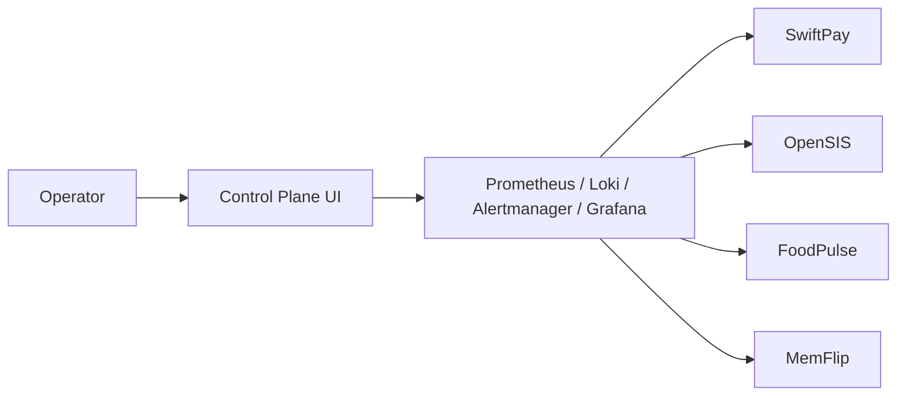

# DevOps Easy Learning Portfolio Snapshot

## Purpose

This document is the short-form portfolio narrative for the workspace.

Use it when someone needs to understand, in a few minutes, why this project is technically serious and what it demonstrates beyond a standard local demo stack.

## One-Sentence Summary

DevOps Easy Learning is a mixed-workload platform engineering lab where one control plane operates a microservices app, a legacy monolith, a resilience lab, and a lightweight onboarding app through shared observability, incident workflows, and Kubernetes-minded platform contracts.

## What This Project Proves

This repo demonstrates that platform engineering work is not only about deploying applications.

It also includes:

- normalizing very different applications into one operator model
- creating a control plane that is operationally useful, not just visually attractive
- validating health, metrics, logs, alerts, and runbooks together
- executing and documenting incident drills
- making local development choices that support a future Kubernetes migration

## Platform At A Glance

## The Four Workload Stories

### SwiftPay

What it shows:

- microservices health
- queue-backed workflows
- business telemetry
- service-to-service failure handling

Why it matters:

- this is the strongest microservices operations story in the workspace

### OpenSIS

What it shows:

- legacy application platforming
- Vault-backed secret delivery
- exporter-driven runtime visibility
- a stronger GitOps and Kubernetes posture

Why it matters:

- this is the strongest “modernizing an existing system” story in the workspace

### FoodPulse

What it shows:

- failover behavior
- stateful dependencies
- routing and HA concerns
- storage and logging discipline

Why it matters:

- this is the strongest resilience and incident-lab story in the workspace

### MemFlip

What it shows:

- simplest onboarding path
- lightweight health and metrics integration
- the cleanest first migration candidate

Why it matters:

- this is the best reference workload for repeatable onboarding and early Kubernetes translation

## What Makes The Control Plane Credible

The control plane is not a mock dashboard.

It is backed by:

- live blackbox probes
- Prometheus recording rules and alerts
- Loki-backed log workflows
- app-specific operator pages
- executed drill evidence
- operator scripts that validate both platform and workloads

## Production-Style Behaviors Already Present

Even before Kubernetes, the workspace already reflects several production-style decisions:

- central observability instead of app-specific monitoring islands
- bounded Docker log rotation to avoid silent disk growth
- Postgres chosen as the strategic control-plane database direction
- app-specific alerts and metrics instead of generic host-only dashboards
- documented incident response and runbook handoff
- explicit workstation bootstrap for macOS and Linux

## Strongest Evidence In The Repo

Reviewers who want proof rather than claims should start with:

- [README.md](README.md)
- [WORKSPACE-ARCHITECTURE.md](WORKSPACE-ARCHITECTURE.md)
- [KUBERNETES-MIGRATION-PLAN.md](KUBERNETES-MIGRATION-PLAN.md)
- [JOURNEY-RUNBOOK.md](JOURNEY-RUNBOOK.md)
- [INCIDENT-RESPONSE.md](INCIDENT-RESPONSE.md)
- [Obervability-Stack/docs/INCIDENT_DRILLS.md](Obervability-Stack/docs/INCIDENT_DRILLS.md)

## Suggested Screenshot Set

The strongest Phase 7 screenshot pack should include:

1. Presenter landing page
2. Simplified dashboard
3. Services page with managed apps
4. One app detail page
5. Alerts page
6. Notifications / resolved history page
7. Demo Center
8. One live app UI
9. One incident drill doc
10. One architecture diagram

## Suggested Talking Points For Reviewers

- one control plane, four different workload stories
- real observability and real alerting, not static screenshots
- incidents were executed and documented
- local decisions were made with Kubernetes in mind
- environment separation and migration planning are now explicit

## Why This Is A Strong Portfolio Piece

Many projects demonstrate that an app can run.

This one demonstrates:

- platform thinking
- operational discipline
- observability design
- incident response maturity
- migration planning

That is a much stronger signal for DevOps, SRE, and platform engineering work than a single happy-path deployment repo.
