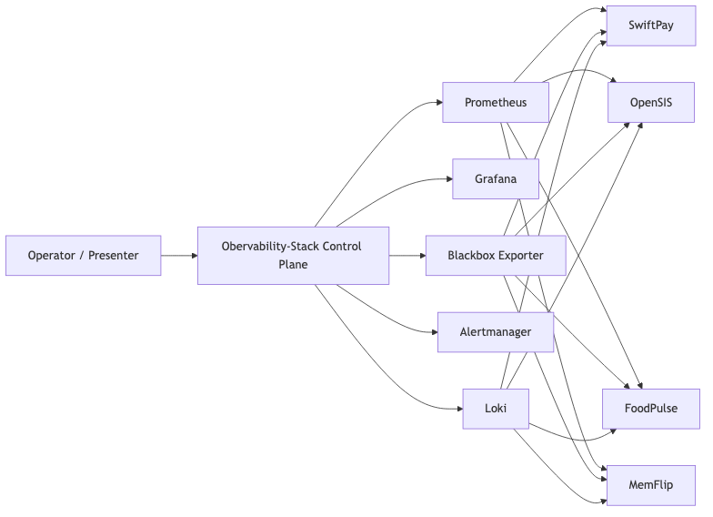
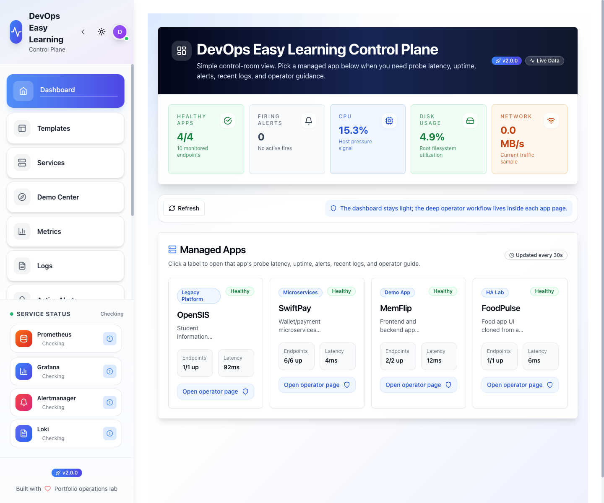
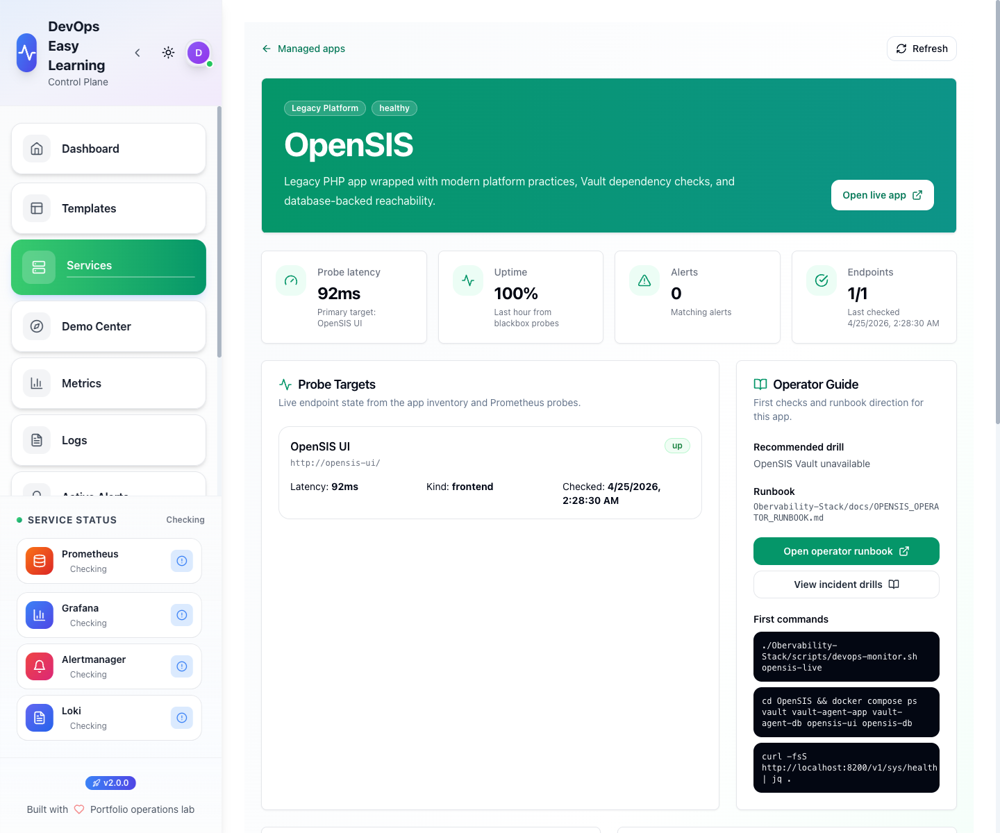
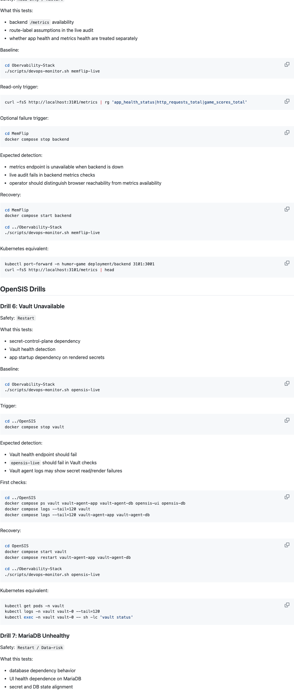

# Internal Developer Platform

Internal Developer Platform is a local-first platform engineering environment built to show how one control plane can operate very different workload styles without flattening their differences.

This is not a collection of unrelated demo repos. It is a deliberately mixed environment where a shared control plane observes, compares, troubleshoots, and documents four distinct application stories:

- `SwiftPay`: microservices, queues, business metrics, and service-to-service failure handling
- `OpenSIS`: a legacy monolith wrapped with modern secrets, runtime health, and platform discipline
- `FoodPulse`: resilience, failover, and infrastructure behavior under pressure
- `MemFlip`: a lightweight onboarding path and a simple reference pattern

The center of that experience is `Obervability-Stack`, which acts as the operator control plane for health, probes, alerts, logs, runbooks, and incident evidence.

## Repository Topology

The platform is now in a controlled repository-transition state.

The child workload repositories have been refreshed and are no longer stale:

- [MemFlip](https://github.com/eseosaiyangbe/MemFlip)
- [SwiftPay](https://github.com/eseosaiyangbe/SwiftPay)
- [FoodPulse](https://github.com/eseosaiyangbe/FoodPulse)
- [OpenSIS](https://github.com/eseosaiyangbe/OpenSIS)
- [Obervability-Stack](https://github.com/eseosaiyangbe/Obervability-Stack)

This central repository still contains those workload directories locally during
the transition, but the long-term target is:

- one central `Internal Developer Platform` repo
- one authoritative repo per workload

The operating model and transition rules are documented in
[PLATFORM-IDENTITY-AND-REPO-MODEL.md](PLATFORM-IDENTITY-AND-REPO-MODEL.md) and
[CENTRAL-REPO-OPERATING-MODEL.md](CENTRAL-REPO-OPERATING-MODEL.md).

## What This Repo Demonstrates

Most portfolio projects show one application running well on a good day.

This workspace demonstrates something harder:

- onboarding mixed workloads into one operating model
- exposing real health, latency, metrics, logs, alerts, and operator guidance
- executing incident drills instead of only writing theoretical runbooks
- documenting commands, failures, and fixes as reusable operator evidence
- preparing local platform decisions for a future Kubernetes path with separate `dev` and `prod` thinking

This makes the repo useful to:

- hiring managers evaluating platform and DevOps depth
- engineers who want a realistic local operations lab
- students learning how observability and incident response connect to real systems

## Workspace At A Glance

| Area | Role | Local URL |
|---|---|---|
| `Obervability-Stack` | Shared observability and operator control plane | `http://localhost:4000` |
| `SwiftPay` | Flagship microservices workload | `http://localhost:8081` |
| `OpenSIS` | Legacy monolith with platform wrapper | `http://localhost:8088` |
| `FoodPulse` | Resilience and failover lab | `http://localhost:8090` |
| `MemFlip` | Lightweight onboarding/demo workload | `http://localhost:8080` |

## What Makes This Different

This workspace is intentionally opinionated.

It does not treat all apps the same:

- `SwiftPay` is where service decomposition, queue depth, transaction flow, and business telemetry matter
- `OpenSIS` is where secret delivery, exporter health, runtime wrapping, and migration posture matter
- `FoodPulse` is where failover behavior, storage pressure, and HA routing matter
- `MemFlip` is where fast onboarding and lightweight operational patterns matter

That gives the control plane a real job: normalize operator experience without pretending every workload should look identical under the hood.

## Core Platform Story

The platform is built around one operator loop:

1. start workloads with clear local contracts
2. probe and scrape them from a shared observability plane
3. surface health, alerts, logs, versions, and runbooks in one control plane
4. execute drills and recovery steps against real failure modes
5. carry the validated operating model forward into Kubernetes planning

## How To Review This Repo

If you are evaluating the project quickly, use this order:

1. start with the visual highlights below to understand the platform shape
2. read [PORTFOLIO-SNAPSHOT.md](PORTFOLIO-SNAPSHOT.md) for the short-form project narrative
3. read [WORKSPACE-ARCHITECTURE.md](WORKSPACE-ARCHITECTURE.md) for the system model and workload roles
4. read [KUBERNETES-MIGRATION-PLAN.md](KUBERNETES-MIGRATION-PLAN.md) to see how the local lab maps to the target platform direction
5. read [PHASE7-K3S-DEV-CERTIFICATION.md](PHASE7-K3S-DEV-CERTIFICATION.md) for the full Kubernetes development acceptance result
6. read [INCIDENT-RESPONSE.md](INCIDENT-RESPONSE.md) and [JOURNEY-RUNBOOK.md](JOURNEY-RUNBOOK.md) for proof that incidents, fixes, and operator workflows were executed for real

If you want to run it instead of just review it:

1. bootstrap the workstation with the platform script for your OS
2. start the repos in the workspace order shown below
3. run `./Obervability-Stack/scripts/devops-monitor.sh operator`
4. use [DEMO-WALKTHROUGH.md](DEMO-WALKTHROUGH.md) as the guided live path

## Visual Highlights

These are the four visuals I recommend as the root portfolio surface because they explain the platform fastest without overloading the first page:

- architecture direction
- control-plane operator view
- app-specific operator handoff
- incident-drill evidence

| Architecture Direction | Control-Plane Dashboard |
|---|---|
|  |  |
| Repo-native architecture map generated from the Phase 7 Mermaid source. | The live operator dashboard that anchors the platform story. |

| App Operator Handoff | Incident Drill Evidence |
|---|---|
|  |  |
| The app detail page proves the handoff from inventory to real operator context. | The drill catalog makes incident practice part of the product story instead of an afterthought. |

The broader six-visual pack remains available through [PHASE7-VISUAL-CAPTURE-LOG.md](PHASE7-VISUAL-CAPTURE-LOG.md) and [VISUAL-EVIDENCE-PACK.md](VISUAL-EVIDENCE-PACK.md).

## Production-Minded Decisions Already In Place

This is still a local Compose-first proving ground, but several decisions already reflect production-style thinking:

- shared observability instead of per-app siloed dashboards
- bounded Docker log rotation to prevent silent disk exhaustion
- PostgreSQL selected as the long-term control-plane database direction
- Traefik selected as the strategic Kubernetes ingress direction
- environment-driven configuration instead of hard-coded local assumptions
- explicit operator runbooks and incident documentation
- app-specific metrics and alerts rather than generic “up/down only” monitoring
- a growing separation between presentation flow and operator truth

## Quick Start

Use the workstation bootstrap script first on a fresh machine.

macOS:

```bash
./scripts/bootstrap-macos-userland.sh
```

Linux:

```bash
./scripts/bootstrap-linux-userland.sh
```

Both bootstrap paths install Docker tooling, Kubernetes tooling, Terraform, cloud CLIs, and `promtool`, so rule validation and operator checks work consistently on macOS and Linux.

If you want to open the local `k3s` slices in a browser through Traefik, populate the local host mappings after bootstrap:

```bash
./scripts/setup-devops-local-hosts.sh
```

If you only want to preview the generated line first:

```bash
./scripts/setup-devops-local-hosts.sh --print
```

Then the browser entrypoints are:

- `http://controlplane.devops.local`
- `http://grafana.devops.local`
- `http://vault.devops.local`
- `http://memflip.devops.local`
- `http://www.swiftpay.devops.local`
- `http://foodpulse.devops.local`
- `http://opensis.devops.local`

Recommended workspace commands:

```bash
./scripts/workspace-start.sh
./scripts/workspace-stop.sh
```

Force a rebuild only when you actually need one:

```bash
./scripts/workspace-start.sh --rebuild
```

What `./scripts/workspace-start.sh` does:

1. Start `Obervability-Stack`
2. Start `SwiftPay`
3. Start `OpenSIS`
4. Start `FoodPulse`
5. Start `MemFlip`
6. Wait for the control-plane app snapshot to stabilize
7. Run the shared operator check

Start the full workspace:

```bash
./scripts/workspace-start.sh
```

If you want the underlying repo-by-repo commands instead of the wrapper:

```bash
cd Obervability-Stack && docker compose up -d
cd ../SwiftPay && docker compose up -d
cd ../OpenSIS && ./scripts/compose-start.sh
cd ../FoodPulse && cp .env.example .env && ./scripts/start.sh
cd ../MemFlip && cp .env.example .env && docker compose up -d
cd .. && ./Obervability-Stack/scripts/devops-monitor.sh operator
```

Apple Silicon note for `OpenSIS`: the wrapper automatically uses `./scripts/compose-start.sh --build-local`.

Target healthy result:

```text
Control plane smoke check passed
Inventory validation passed
All monitored apps are currently healthy
```

## Key Documents

| Doc | Purpose |
|---|---|
| [PROJECT-ROADMAP.md](PROJECT-ROADMAP.md) | roadmap, phase state, and success criteria |
| [PLATFORM-IDENTITY-AND-REPO-MODEL.md](PLATFORM-IDENTITY-AND-REPO-MODEL.md) | canonical platform naming, target repository model, and extraction plan |
| [CENTRAL-REPO-OPERATING-MODEL.md](CENTRAL-REPO-OPERATING-MODEL.md) | central-versus-child repo ownership and the recommended multi-repo operating model |
| [PORTFOLIO-SNAPSHOT.md](PORTFOLIO-SNAPSHOT.md) | short-form portfolio narrative and suggested evidence pack |
| [VISUAL-EVIDENCE-PACK.md](VISUAL-EVIDENCE-PACK.md) | screenshot and diagram capture plan for the Phase 7 portfolio pack |
| [PHASE7-VISUAL-CAPTURE-LOG.md](PHASE7-VISUAL-CAPTURE-LOG.md) | live screenshot and diagram capture inventory for the Phase 7 portfolio pack |
| [PHASE7-K3S-DEV-CERTIFICATION.md](PHASE7-K3S-DEV-CERTIFICATION.md) | formal Phase 7 Kubernetes development certification result |
| [WORKSPACE-ARCHITECTURE.md](WORKSPACE-ARCHITECTURE.md) | root architecture narrative and platform model |
| [ENVIRONMENT-MODEL.md](ENVIRONMENT-MODEL.md) | root `dev` and `prod` environment expectations |
| [KUBERNETES-MIGRATION-PLAN.md](KUBERNETES-MIGRATION-PLAN.md) | phased migration framing from local Compose to Kubernetes |
| [CONTROL-PLANE-K8S-PLAN.md](CONTROL-PLANE-K8S-PLAN.md) | deeper Kubernetes plan for the shared observability control plane |
| [Obervability-Stack/k8s/README.md](Obervability-Stack/k8s/README.md) | owned Kubernetes path for the shared observability control plane |
| [MEMFLIP-K8S-CANDIDATE.md](MEMFLIP-K8S-CANDIDATE.md) | rationale for using MemFlip as the first workload migration candidate |
| [OPENSIS-K8S-ASSESSMENT.md](OPENSIS-K8S-ASSESSMENT.md) | assessment of the existing OpenSIS Kubernetes tree against the current workspace standards |
| [MemFlip/docs/local/12-phase7-k8s-dev.md](MemFlip/docs/local/12-phase7-k8s-dev.md) | first concrete k3s-based Kubernetes implementation slice for MemFlip in `dev` |
| [WORKSPACE-SETUP-MATRIX.md](WORKSPACE-SETUP-MATRIX.md) | startup commands, ports, health checks, and aliases |
| [WORKSTATION-BOOTSTRAP.md](WORKSTATION-BOOTSTRAP.md) | macOS/Linux tool installation guide |
| [METRICS-STRATEGY.md](METRICS-STRATEGY.md) | production-grade metrics standards for platform and apps |
| [INCIDENT-RESPONSE.md](INCIDENT-RESPONSE.md) | incident investigations, root causes, and follow-ups |
| [JOURNEY-RUNBOOK.md](JOURNEY-RUNBOOK.md) | command-by-command build and operations record |
| [Obervability-Stack/docs/OPERATOR_HEALTH_WORKFLOW.md](Obervability-Stack/docs/OPERATOR_HEALTH_WORKFLOW.md) | standard first-response workflow |

## Demo And Operator Entry Points

Demo walkthrough:

- [DEMO-WALKTHROUGH.md](DEMO-WALKTHROUGH.md)

Primary operator commands:

```bash
./Obervability-Stack/scripts/devops-monitor.sh operator
./Obervability-Stack/scripts/devops-monitor.sh swiftpay-live
./Obervability-Stack/scripts/devops-monitor.sh opensis-live
./Obervability-Stack/scripts/devops-monitor.sh foodpulse-live
./Obervability-Stack/scripts/devops-monitor.sh memflip-live
```

## Evidence Already In The Repo

This workspace already contains evidence that it is more than a visual demo:

- live control-plane and workload smoke checks
- app-specific operator handoff pages
- executed incident drills with recovery evidence
- incident-response writeups for real failures
- journey-level documentation of commands, problems, decisions, and fixes

Executed drill categories include:

- MemFlip backend failure
- SwiftPay transaction worker failure
- OpenSIS Vault failure
- FoodPulse Redis failover
- control-plane probe drift and alert-path issues

## Current Roadmap Position

The project is now in Phase 7: `Production-Style Maturity And Portfolio Packaging`.

That means the engineering foundation is already in place. The current job is to make the platform story understandable, credible, and portable without relying on a live narrated demo.

Phase 7 focuses on:

- a stronger architecture narrative
- portfolio-ready documentation and visuals
- production-style environment and deployment framing
- a concrete Kubernetes migration path

The current Phase 7 documentation spine is:

- [PORTFOLIO-SNAPSHOT.md](PORTFOLIO-SNAPSHOT.md)
- [VISUAL-EVIDENCE-PACK.md](VISUAL-EVIDENCE-PACK.md)
- [PHASE7-K3S-DEV-CERTIFICATION.md](PHASE7-K3S-DEV-CERTIFICATION.md)
- [WORKSPACE-ARCHITECTURE.md](WORKSPACE-ARCHITECTURE.md)
- [ENVIRONMENT-MODEL.md](ENVIRONMENT-MODEL.md)
- [KUBERNETES-MIGRATION-PLAN.md](KUBERNETES-MIGRATION-PLAN.md)
- [CONTROL-PLANE-K8S-PLAN.md](CONTROL-PLANE-K8S-PLAN.md)
- [Obervability-Stack/k8s/README.md](Obervability-Stack/k8s/README.md)
- [MEMFLIP-K8S-CANDIDATE.md](MEMFLIP-K8S-CANDIDATE.md)
