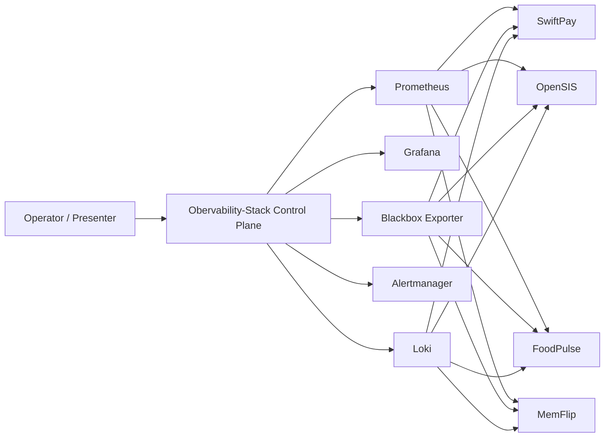

# DevOps Easy Learning Workspace Architecture

## Purpose

This document explains how the workspace operates as one platform instead of five disconnected repos.

The key architectural idea is simple:

- keep each workload honest to its own runtime style
- normalize the operator experience through one shared control plane
- use local Docker Compose as the proving ground for an eventual Kubernetes model

## System Intent

The workspace is designed to answer one practical platform question:

How do we operate microservices, a legacy monolith, a failover lab, and a lightweight demo app from one consistent control plane without erasing the operational differences that make each workload interesting?

The answer in this repo is:

- shared observability
- shared operator workflow
- workload-specific metrics and runbooks
- environment-driven startup contracts
- documented incident response

## Architecture Overview



## Platform Layers

The workspace has three practical layers.

### Layer 1: Managed Workloads

These are the application repos being operated:

- `SwiftPay`
- `OpenSIS`
- `FoodPulse`
- `MemFlip`

Each app keeps its own runtime shape, dependencies, and operational personality.

### Layer 2: Shared Runtime Integration

The common local integration layer is the Docker network:

```text
observability-net
```

That network provides stable service discovery between the control plane and the managed workloads.

This matters because the control plane should depend on stable service targets and health contracts, not on fragile human memory or ad hoc container browsing.

### Layer 3: Control Plane

`Obervability-Stack` is the platform-facing hub.

It owns:

- Prometheus scraping and rule evaluation
- Blackbox probing
- Alertmanager routing
- Loki log aggregation
- Grafana dashboards
- the Next.js operator UI
- app inventory and operator guidance

This is the architectural move that turns the repo set into one platform.

## Why These Apps Were Chosen

The workloads are intentionally different so the platform has to solve real integration problems.

### `SwiftPay`

Architecture:

- React frontend
- Node.js microservices
- PostgreSQL
- Redis
- RabbitMQ

Why it belongs here:

- strongest example of service-to-service health
- best place for business metrics and queue-backed workflows
- best workload for showing component-level failure instead of single-app uptime only

### `OpenSIS`

Architecture:

- PHP/Apache monolith
- MariaDB
- Vault-based secret delivery
- exporter coverage for database, Vault synthetic checks, and Apache runtime

Why it belongs here:

- demonstrates how a legacy app can be wrapped with modern operational practices
- introduces secrets, runtime exporters, and a stronger Kubernetes/GitOps direction
- forces the control plane to support something more complex than a clean greenfield service stack

### `FoodPulse`

Architecture:

- workspace-owned UI
- workspace-owned API
- Redis master/replica/Sentinel
- Postgres primary/replica topology
- HAProxy

Why it belongs here:

- the best workload for failover, routing, and resilience drills
- the best place to surface infrastructure-driven incidents instead of only application bugs

### `MemFlip`

Architecture:

- lightweight frontend
- Node backend
- PostgreSQL
- Redis

Why it belongs here:

- simplest onboarding pattern in the workspace
- easiest workload for proving control-plane conventions cleanly
- useful as the “minimum viable managed app” reference

## Workload-To-Control-Plane Mapping

```mermaid
flowchart TD
    SP["SwiftPay"] --> SP1["Blackbox probes"]
    SP --> SP2["Service metrics"]
    SP --> SP3["Business signals"]
    SP --> SP4["Operator guidance"]

    OS["OpenSIS"] --> OS1["Blackbox probes"]
    OS --> OS2["MariaDB exporter"]
    OS --> OS3["Vault synthetic checks"]
    OS --> OS4["Apache runtime metrics"]

    FP["FoodPulse"] --> FP1["UI/API health"]
    FP --> FP2["Failover drills"]
    FP --> FP3["Storage and logging discipline"]

    MF["MemFlip"] --> MF1["Frontend/backend health"]
    MF --> MF2["Simple onboarding pattern"]
    MF --> MF3["Reference runbook path"]
```



## Control Plane Contract

For a workload to participate cleanly in this platform, it should provide:

1. a stable runtime alias on `observability-net`
2. a documented startup command
3. a health endpoint or probe target
4. a local browser URL if it is user-facing
5. a metrics story, even if small
6. an operator handoff or runbook path

This contract matters more than the implementation language.

It is what lets the control plane operate mixed systems without pretending they are all the same application.

## Current Alias Model

| App | Alias / Aliases | Purpose |
|---|---|---|
| `OpenSIS` | `opensis-ui`, `opensis-mysqld-exporter`, `opensis-vault-checker`, `opensis-apache-exporter` | UI probes and deeper runtime health |
| `SwiftPay` | `swiftpay-frontend`, `swiftpay-api-gateway`, `swiftpay-auth-service`, `swiftpay-wallet-service`, `swiftpay-transaction-service`, `swiftpay-notification-service` | service-level availability and metrics |
| `MemFlip` | `memflip-frontend`, `memflip-backend` | frontend/backend health model |
| `FoodPulse` | `foodpulse-ui`, `foodpulse-api` | UI availability and API health/metrics |

## Operator Mental Model

Operators should think about the workspace like this:

```text
Operator -> Control Plane -> App inventory -> Health -> Logs -> Metrics -> Runbook -> Incident response
```

That sequence is deliberate.

The UI is not supposed to replace underlying observability systems.
It is supposed to shorten the path from “something looks wrong” to “I know where to go next.”

## Environment Model

The local workspace is still Compose-first, but the intended long-term environment model is:

- `dev`: iterative validation, demos, drills, and integration testing
- `prod`: tighter secrets, backups, routing, retention, and operational controls

That changes how we make decisions now:

- prefer explicit environment variables over hidden defaults
- prefer databases and services that translate cleanly into separate environment backends
- prefer stable names, probes, and startup contracts that can become Kubernetes resources later

## Kubernetes Direction

Compose is not the destination.
Compose is the proving ground.

The Kubernetes direction for this workspace is:

- shared control-plane services become namespace-scoped platform components
- app services become environment-specific workloads
- local aliases become Kubernetes Services
- env files become ConfigMaps and Secrets
- one-off bootstraps become Jobs or init flows
- stateful services become PVC-backed StatefulSets or managed external services

The migration plan is documented separately in [KUBERNETES-MIGRATION-PLAN.md](KUBERNETES-MIGRATION-PLAN.md).

Supporting Phase 7 documents:

- [ENVIRONMENT-MODEL.md](ENVIRONMENT-MODEL.md)
- [CONTROL-PLANE-K8S-PLAN.md](CONTROL-PLANE-K8S-PLAN.md)
- [MEMFLIP-K8S-CANDIDATE.md](MEMFLIP-K8S-CANDIDATE.md)

## Architectural Risks We Are Managing

### 1. Control Plane Drift

If the control plane says one thing and the live workloads say another, trust collapses quickly.

Mitigation:

- inventory validation
- live smoke checks
- runbook-backed operator flows
- documented incidents when the control plane is wrong

### 2. Docker-Only Assumptions

If we overfit everything to local Compose behavior, the Kubernetes migration becomes expensive and error-prone.

Mitigation:

- stable service contracts
- explicit probes
- cleaner environment boundaries
- migration planning before implementation

### 3. Narrative Drift

If the repo no longer tells a coherent story, the technical quality becomes harder for others to recognize.

Mitigation:

- strong root docs
- architecture visuals
- clear workload roles
- incident evidence tied back to the platform model

## What This Architecture Proves

This workspace proves that a shared control plane can:

- normalize operations across different application styles
- surface real health and failure signals without hiding workload differences
- connect health, metrics, logs, alerts, and runbooks into one operator journey
- provide a credible bridge from local development to Kubernetes-minded platform design

That is the core engineering story for Phase 7.
