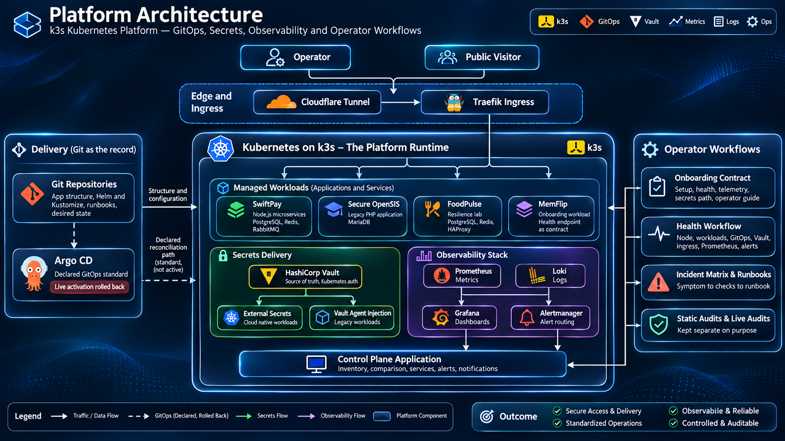
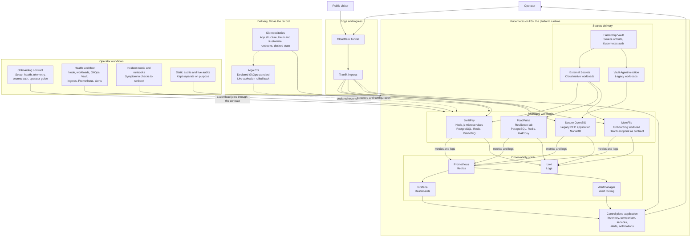
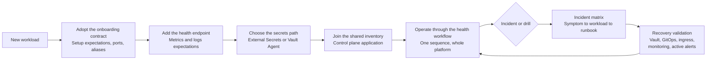

# Platform Architecture

This document is the architecture design of record for the Internal Developer Platform. The image above is rendered from the Mermaid source in this file, so the picture and the source never drift apart. It supersedes the Phase 7 architecture screenshot (`output/playwright/phase7/phase7-12-architecture-diagram.png`) as the current design record.

## The design in one paragraph

One platform, not five unrelated applications. Operator and public traffic enter through Cloudflare Tunnel and Traefik ingress into a Kubernetes on k3s runtime. The runtime hosts four managed workloads with deliberately different shapes: SwiftPay (cloud native microservices), Secure OpenSIS (a legacy PHP and MariaDB monolith), FoodPulse (a resilience and failover lab), and MemFlip (a lightweight onboarding workload). Shared capabilities sit below the workloads: HashiCorp Vault as the secret source of truth, delivered through External Secrets for cloud native workloads and Vault Agent injection for the legacy application; a single observability stack (Prometheus, Loki, Grafana, Alertmanager) feeding the control plane application, which presents inventory, comparison, services, alerts, and notifications; and operator workflows (onboarding contract, health workflow, incident matrix and runbooks, and static and live audits kept separate on purpose). Git is the delivery record. Argo CD is the declared GitOps standard; its live activation was rolled back after node runtime instability, and the diagram draws that path dashed because a GitOps controller that cannot be trusted cannot be the delivery record.

## Architecture diagram, Mermaid source

## Flow diagram: how a workload joins and is operated, Mermaid source

## Notes

- Audit counts and validation evidence for this design live in the platform case study and the Phase 6 and Phase 7 records in this repository. They are lab validation audits, point in time, not production service level results.
- The control plane application is provided by the `Obervability-Stack` repository and runs at `https://portfolio.eseosadevbox.com`.
